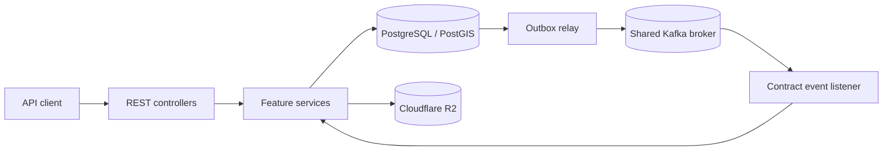

# Properties Service

A Spring Boot REST service for managing rental property locations, buildings, rooms, prices, occupancy, and images. It gives API clients a single place to manage property data while keeping occupancy in sync with contract events.

The service is part of a larger rental system. Developers integrating its API and maintainers running the service are the main readers of this repository. The code provides an HTTP backend; there is no user interface in this repository.

## Contents

- [Features](#features)
- [Technology](#technology)
- [Quick start](#quick-start)
- [Using the API](#using-the-api)
- [Architecture at a glance](#architecture-at-a-glance)
- [Project layout](#project-layout)
- [Testing](#testing)
- [Documentation](#documentation)

## Features

The following capabilities are implemented in the current source:

| Capability | What it provides |
| --- | --- |
| Locations | Create, list, update, and delete provinces and wards; look up wards by province. |
| Buildings | Manage buildings and search them by filters or nearby coordinates using PostGIS. |
| Rooms and types | Manage room records and room types, including rooms within a building. |
| Room prices | Set prices and read current prices or price history. |
| Occupancy | Read room occupants, history, and summaries. Contract events update the occupant projection and room status; there are no occupant write endpoints. |
| Images | Upload and manage building/room images in S3-compatible Cloudflare R2 storage. |
| Events | Publish property changes through a database outbox and consume contract events from Kafka with retry and dead-letter handling. |
| Service operations | Flyway database migrations, Actuator health endpoints, optional Eureka discovery, and optional OpenAPI/Swagger UI. |

## Technology

| Technology | Version in repository | Purpose |
| --- | --- | --- |
| Java | 21 toolchain | Application language and runtime. |
| Gradle | 9.8.1 wrapper | Build and test automation. |
| Spring Boot | 4.1.1 | Web API, validation, data access, security, Kafka integration, Actuator, and Flyway integration. |
| Spring Cloud | 2025.1.3 BOM | Eureka client dependency management. |
| PostgreSQL/PostGIS | Compose image `postgis/postgis:16-3.4` | Persistent and spatial data. |
| Hibernate Spatial | Managed by Spring Boot | Spatial persistence and queries. |
| Flyway | Managed by Spring Boot | Versioned SQL migrations. |
| Apache Kafka | Broker supplied externally | Property and contract event transport. |
| AWS SDK for Java S3 | 2.54.18 | S3-compatible R2 object storage. |
| MapStruct | 1.6.3 | DTO mapping. |
| springdoc OpenAPI | 3.1.1 | Optional API documentation UI and JSON. |
| JUnit and Testcontainers | JUnit managed by Spring Boot; Testcontainers 1.21.3 | Unit and container-backed integration tests. |

Other dependencies and their exact declarations are in [`build.gradle.kts`](build.gradle.kts).

## Quick start

You need Git, JDK 21, Docker Engine with Compose, access to a Cloudflare R2 endpoint and bucket, and the larger rental system's shared Kafka broker and topics. The supplied Compose file starts **this service and PostGIS only**. It expects the external network `rental-system_rental-net` and Kafka topics to exist; start the stack that owns them first. The `.env` template contains placeholders and must be filled with your own local values.

1. Clone the repository:

   ```bash
   git clone https://github.com/RentalSystem-qiawuy-task/properties-service.git
   cd properties-service
   ```

2. Create local configuration and set real database and R2 credentials. On Windows PowerShell:

   ```powershell
   Copy-Item .env.example .env
   # Edit .env: replace DB_PASSWORD and all R2 change-me values.
   ```

   On Linux/macOS:

   ```bash
   cp .env.example .env
   # Edit .env: replace DB_PASSWORD and all R2 change-me values.
   ```

   `.env` is ignored by Git. Keep credentials out of commits. The shared Kafka broker should be reachable as `kafka:9092` from the external Compose network, or set `KAFKA_DOCKER_BOOTSTRAP_SERVERS` to its reachable address.

3. Verify Java and build with the included wrapper:

   ```powershell
   java -version
   .\gradlew.bat build
   ```

   ```bash
   java -version
   sh ./gradlew build
   ```

   `build` runs tests; container-backed tests require a working Docker environment. The wrapper downloads Gradle and dependencies on first use.

4. After the shared Kafka stack and external network are ready, start this service and PostGIS:

   ```bash
   docker compose up -d --build
   docker compose ps
   ```

5. Check the service at its default host port:

   ```bash
   curl http://localhost:8083/actuator/health
   ```

   Swagger UI is available at `http://localhost:8083/swagger-ui/index.html` for both Compose and direct Spring Boot runs. Set `OPENAPI_ENABLED=false` and `SWAGGER_UI_ENABLED=false` to disable it. Health depends on the configured services, including the database and Kafka.

For host-based `bootRun`, environment variable details, JAR packaging, and troubleshooting, follow the [developer guide](HELP.md). In particular, Spring Boot does **not** load the Compose `.env` file automatically when launched from a terminal or IDE.

## Using the API

Endpoints use the `/api/v1` prefix. Once the service is running, a read-only request is:

```bash
curl http://localhost:8083/api/v1/provinces
```

| Area | Example route | Use |
| --- | --- | --- |
| Locations | `GET /api/v1/provinces`, `GET /api/v1/wards` | Browse administrative locations. |
| Buildings | `GET /api/v1/buildings`, `GET /api/v1/buildings/search` | List and search buildings. The nearby search also requires coordinates and a radius. |
| Rooms | `GET /api/v1/rooms`, `GET /api/v1/room-types` | Browse rooms and types. |
| Prices | `GET /api/v1/rooms/{roomId}/prices/current` | Read a room's current price. |
| Occupancy | `GET /api/v1/rooms/{roomId}/occupants` | Read occupants through a trusted gateway identity. |
| Images | `GET /api/v1/images/buildings/{buildingId}` | List a building's images. |

The API returns an `ApiResponse` envelope. Large Snowflake IDs are serialized as decimal strings in JSON, so clients should retain them as strings. Occupancy routes require trusted gateway headers and role checks; do not expose the backend directly to untrusted clients. See the [API documentation index](docs/api/README.md) for request fields, pagination, image uploads, validation, and endpoint-specific behavior.

## Architecture at a glance

The application entry point is `PropertiesServiceApplication`. Controllers under `features/*/api` call feature services; repositories use JPA or JDBC for PostgreSQL/PostGIS. Flyway applies SQL migrations at startup. Property changes are saved to an outbox, then relayed to Kafka. Incoming contract events update the read-only occupant projection and room status. Image services use R2 for object storage.



The [architecture guide](docs/ARCHITECTURE.md) describes development conventions; [HELP.md](HELP.md) explains the running components and configuration in more detail.

## Project layout

```text
.
├── build.gradle.kts, settings.gradle.kts  # Single Gradle project
├── gradlew, gradlew.bat, gradle/wrapper/   # Pinned Gradle wrapper
├── Dockerfile, docker-compose.yaml        # Container build and local stack
├── .env.example                            # Local variable template
├── src/
│   ├── main/java/fptu/semester8/mss301/propertiesservice/
│   │   ├── common/id/                      # Snowflake IDs
│   │   ├── config/                         # Application integrations/security
│   │   └── features/                       # Property features and event flow
│   ├── main/resources/                     # Spring config and Flyway migrations
│   └── test/                               # Unit and integration tests
├── docs/                                   # Architecture, configuration, API docs
├── scripts/                                # Optional administrative data import
└── HELP.md                                 # Detailed developer guide
```

## Testing

The Gradle `test` task runs JUnit tests, including integration tests backed by Testcontainers. Docker must be available for the complete suite.

```powershell
.\gradlew.bat test
```

```bash
sh ./gradlew test
```

After a successful run, view `build/reports/tests/test/index.html`. This README does not claim a passing build or CI status; see [HELP.md](HELP.md#testing) for test details.

## Documentation

- [Developer guide](HELP.md): environment setup, run modes, configuration, debugging, and troubleshooting.
- [API documentation](docs/api/README.md): feature endpoints and request/response contracts.
- [Architecture guidelines](docs/ARCHITECTURE.md): source organization and development conventions.
- [Configuration notes](docs/CONFIGURATION.md): local infrastructure background; check current `application.yaml` for authoritative defaults.

This repository currently has no root `LICENSE`, `CONTRIBUTING.md`, or `CHANGELOG.md` file. It also has no checked-in demo screenshots or GitHub Actions workflow, so no license, demo, or CI status is asserted here.
