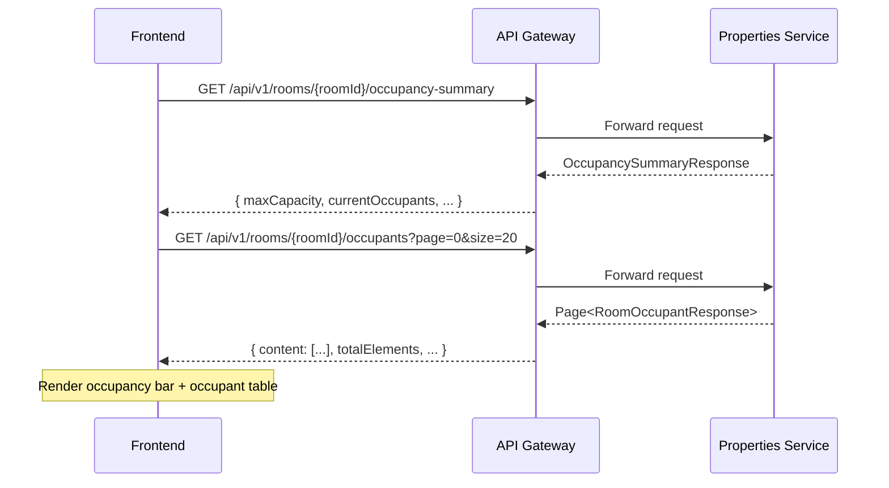

# RoomOccupantController — Người ở phòng

Base path: `/api/v1/rooms`

> Feature **read-only** — dữ liệu được tạo tự động từ sự kiện hợp đồng (contract events) qua Kafka. Frontend **không gọi tạo/sửa/xóa**; chỉ đọc.

---

## 1. Tổng quan kiến trúc & luồng dữ liệu

```
contract-service ──Kafka──► ContractEventListener
                                    │
                            ContractEventProcessor
                             (idempotent, dedup)
                                    │
                         OccupantProjectionService.apply()
                          ┌─────────┼─────────┐
                          │         │         │
                     TenantAdded  TenantRemoved  ContractEnded
                          │         │         │
                     ┌────▼─────────▼─────────▼────┐
                     │    room_occupant  (table)    │
                     └─────────────────────────────┘
                                    │
                     RoomOccupancyStatusPolicy.refresh()
                          (cập nhật room.status)
                                    │
                     ┌──────────────▼──────────────┐
                     │  RoomOccupantController      │
                     │  (read-only REST endpoints)  │
                     └─────────────────────────────┘
```

### Các bước xử lý:

1. **Contract-service** publish sự kiện lên Kafka topic (`${property.kafka.contract-topic}`).
2. **ContractEventListener** nhận message, chuyển cho **ContractEventProcessor**.
3. Processor kiểm tra idempotent bằng bảng `processed_event`, rồi gọi **OccupantProjectionService.apply()**.
4. Projection service xử lý theo `eventType`:
   - `TenantAdded` → Tạo bản ghi `room_occupant` mới (status = `ACTIVE`).
   - `TenantRemoved` → Đặt `moveOutDate` và status = `ENDED`.
   - `ContractEnded` → Kết thúc **tất cả** occupant ACTIVE của contract đó.
   - `ContractSigned`, `MoveOutApproved`, `ContractRenewed` → Chỉ cập nhật checkpoint, không tạo/sửa occupant.
5. Sau mỗi sự kiện, **RoomOccupancyStatusPolicy** tự động cập nhật `room.status` thành `OCCUPIED` hoặc `UPCOMING_VACANT`.
6. **OccupancyDateRefreshJob** chạy định kỳ (mặc định mỗi 60 giây) để cập nhật trạng thái phòng khi ngày thay đổi.

---

## 2. Domain model

### RoomOccupantStatus (enum)

| Giá trị | Ý nghĩa |
|---|---|
| `ACTIVE` | Người thuê đang ở phòng |
| `ENDED` | Người thuê đã rời phòng |

### RoomOccupant (entity → bảng `room_occupant`)

| Cột | Kiểu Java | JSON type | Mô tả |
|---|---|---|---|
| `id` | Long | **string** | PK — snowflake ID |
| `contractTenantId` | Long | **string** | FK sang bảng contract_tenant ở contract-service |
| `roomId` | Long | **string** | FK sang bảng `room` |
| `contractId` | Long | **string** | FK sang hợp đồng |
| `userId` | Long | **string** | FK sang user ở user-service |
| `moveInDate` | LocalDate | `"YYYY-MM-DD"` | Ngày vào ở |
| `moveOutDate` | LocalDate \| null | `"YYYY-MM-DD"` \| `null` | Ngày rời phòng (null = chưa rời) |
| `status` | RoomOccupantStatus | `"ACTIVE"` / `"ENDED"` | Trạng thái hiện tại |
| `sourceRevision` | Long | number | Phiên bản event cuối cùng xử lý |
| `createdAt` | Instant | `"ISO-8601 UTC"` | Thời điểm tạo |
| `updatedAt` | Instant | `"ISO-8601 UTC"` | Thời điểm cập nhật |

> **Lưu ý**: Tất cả trường ID (`id`, `contractTenantId`, `roomId`, `contractId`, `userId`) trả về dưới dạng **string** trong JSON (tránh mất độ chính xác JavaScript). Khi FE truyền ID, dùng số dương.

---

## 3. API Endpoints

### 3.1. Danh sách người đang ở phòng (current)

```
GET /api/v1/rooms/{roomId}/occupants?page=0&size=20
```

Trả về những người **đang thực sự ở** phòng tại thời điểm hiện tại (move_in_date ≤ today, và chưa rời hoặc move_out_date ≥ today).

| Param | Kiểu | Mặc định | Ràng buộc |
|---|---|---|---|
| `roomId` | path, số dương | — | Bắt buộc |
| `page` | query, int | `0` | ≥ 0 |
| `size` | query, int | `20` | 1–100 |

**Response**: `ApiResponse<Page<RoomOccupantResponse>>`

```json
{
  "code": 200,
  "message": "Success",
  "data": {
    "content": [
      {
        "id": "898785309339156480",
        "contractTenantId": "898785309339156481",
        "roomId": "898785309339156482",
        "contractId": "898785309339156483",
        "userId": "898785309339156484",
        "moveInDate": "2025-01-15",
        "moveOutDate": null,
        "status": "ACTIVE",
        "sourceRevision": 3,
        "createdAt": "2025-01-15T07:00:00Z",
        "updatedAt": "2025-01-15T07:00:00Z"
      }
    ],
    "totalElements": 1,
    "totalPages": 1,
    "size": 20,
    "number": 0,
    "first": true,
    "last": true
  }
}
```

Sắp xếp mặc định: `moveInDate DESC`, `id DESC`.

---

### 3.2. Lịch sử toàn bộ người ở phòng (history)

```
GET /api/v1/rooms/{roomId}/occupants/history?page=0&size=20
```

Trả về **tất cả** bản ghi occupant của phòng (bao gồm cả ACTIVE và ENDED), không lọc theo ngày.

| Param | Kiểu | Mặc định | Ràng buộc |
|---|---|---|---|
| `roomId` | path, số dương | — | Bắt buộc |
| `page` | query, int | `0` | ≥ 0 |
| `size` | query, int | `20` | 1–100 |

**Response**: `ApiResponse<Page<RoomOccupantResponse>>` — cấu trúc giống endpoint 3.1.

---

### 3.3. Chi tiết một occupant

```
GET /api/v1/rooms/{roomId}/occupants/{occupantId}
```

| Param | Kiểu | Ràng buộc |
|---|---|---|
| `roomId` | path, số dương | Bắt buộc |
| `occupantId` | path, số dương | Bắt buộc |

**Response**: `ApiResponse<RoomOccupantResponse>` — một object duy nhất (không phân trang).

```json
{
  "code": 200,
  "message": "Success",
  "data": {
    "id": "898785309339156480",
    "contractTenantId": "898785309339156481",
    "roomId": "898785309339156482",
    "contractId": "898785309339156483",
    "userId": "898785309339156484",
    "moveInDate": "2025-01-15",
    "moveOutDate": "2025-06-30",
    "status": "ENDED",
    "sourceRevision": 5,
    "createdAt": "2025-01-15T07:00:00Z",
    "updatedAt": "2025-07-01T02:00:00Z"
  }
}
```

**Lỗi**: `404` nếu occupant không tồn tại hoặc `roomId` không khớp.

---

### 3.4. Tổng hợp sức chứa phòng (occupancy summary)

```
GET /api/v1/rooms/{roomId}/occupancy-summary?date=2025-06-15
```

| Param | Kiểu | Mặc định | Ràng buộc |
|---|---|---|---|
| `roomId` | path, số dương | — | Bắt buộc |
| `date` | query, `YYYY-MM-DD` | Ngày hiện tại (server) | Tùy chọn |

**Response**: `ApiResponse<OccupancySummaryResponse>`

```json
{
  "code": 200,
  "message": "Success",
  "data": {
    "roomId": "898785309339156482",
    "maxCapacity": 4,
    "currentOccupants": 3,
    "availableCapacity": 1,
    "overCapacity": false,
    "roomStatus": "OCCUPIED",
    "businessDate": "2025-06-15"
  }
}
```

**OccupancySummaryResponse**

| Field | Kiểu | Mô tả |
|---|---|---|
| `roomId` | string | ID phòng |
| `maxCapacity` | int | Sức chứa tối đa của phòng |
| `currentOccupants` | long | Số người đang ở tại `businessDate` |
| `availableCapacity` | long | `maxCapacity - currentOccupants` (có thể âm) |
| `overCapacity` | boolean | `true` nếu `availableCapacity < 0` |
| `roomStatus` | string | Trạng thái phòng hiện tại (`AVAILABLE`, `OCCUPIED`, `UPCOMING_VACANT`, `MAINTENANCE`) |
| `businessDate` | string `YYYY-MM-DD` | Ngày tính toán |

---

### 3.5. Lịch sử thuê phòng theo user

```
GET /api/v1/rooms/occupancies/users/{userId}?page=0&size=20
```

Trả về tất cả bản ghi occupant của một user, bao gồm ACTIVE và ENDED, chỉ hiển thị phòng thuộc building chưa bị xóa.

| Param | Kiểu | Mặc định | Ràng buộc |
|---|---|---|---|
| `userId` | path, số dương | — | Bắt buộc |
| `page` | query, int | `0` | ≥ 0 |
| `size` | query, int | `20` | 1–100 |

**Response**: `ApiResponse<Page<RoomOccupantResponse>>` — sắp xếp: `move_in_date DESC`, `room_occupant_id DESC`.

---

## 4. Mã lỗi thường gặp

| HTTP | Error code | Khi nào |
|---|---|---|
| `400` | `INVALID_PAGE` | `page < 0`, `size < 1` hoặc `size > 100` |
| `404` | `ROOM_NOT_FOUND` | `roomId` không tồn tại hoặc building đã bị xóa |
| `404` | `ROOM_OCCUPANT_NOT_FOUND` | `occupantId` không tồn tại hoặc không thuộc room |

---

## 5. Gợi ý tích hợp Frontend

### 5.1. Use case chính

| Trang FE | API cần gọi | Mô tả |
|---|---|---|
| Trang chi tiết phòng (Admin) | `GET /{roomId}/occupants` | Hiển thị danh sách người đang ở |
| Trang chi tiết phòng (Admin) | `GET /{roomId}/occupancy-summary` | Hiển thị thanh sức chứa (progress bar) |
| Trang lịch sử phòng (Admin) | `GET /{roomId}/occupants/history` | Danh sách tất cả người từng ở |
| Trang "Phòng của tôi" (Customer) | `GET /occupancies/users/{userId}` | Lịch sử thuê phòng của customer |
| Xem chi tiết occupant | `GET /{roomId}/occupants/{occupantId}` | Thông tin chi tiết một người thuê |

### 5.2. Cách xử lý ID

```javascript
// ID trả về dạng string, lưu nguyên string — không parseInt()
const occupant = response.data.content[0];
const id = occupant.id;        // "898785309339156480" — giữ nguyên string
const userId = occupant.userId; // "898785309339156484" — giữ nguyên string

// Khi gọi API, dùng số dương hoặc string trong URL path
fetch(`/api/v1/rooms/${roomId}/occupants/${id}`);
```

### 5.3. Hiển thị trạng thái

```javascript
const statusMap = {
  ACTIVE: { label: "Đang ở", color: "green", icon: "✓" },
  ENDED:  { label: "Đã rời", color: "gray",  icon: "—" },
};
```

### 5.4. Thanh sức chứa (Occupancy Bar)

```javascript
// Gọi summary endpoint
const summary = await fetch(`/api/v1/rooms/${roomId}/occupancy-summary`);
const { maxCapacity, currentOccupants, availableCapacity, overCapacity } = summary.data;

// Tính phần trăm
const percent = Math.min((currentOccupants / maxCapacity) * 100, 100);

// Hiển thị
// - percent < 75%  → xanh lá
// - 75% ≤ percent < 100% → vàng
// - overCapacity === true → đỏ
```

### 5.5. Phân trang

```javascript
async function fetchOccupants(roomId, page = 0, size = 20) {
  const res = await fetch(
    `/api/v1/rooms/${roomId}/occupants?page=${page}&size=${size}`
  );
  const { data } = await res.json();
  // data.content      — mảng occupant
  // data.totalElements — tổng số bản ghi
  // data.totalPages    — tổng số trang
  // data.number        — trang hiện tại (0-indexed)
  // data.first / data.last — cờ trang đầu/cuối
  return data;
}
```

### 5.6. Sequence diagram — Hiển thị trang chi tiết phòng



---

## 6. Trạng thái phòng (Room Status) — được cập nhật tự động

Feature `roomoccupant` **tự động cập nhật** trường `room.status` dựa trên dữ liệu occupant:

| Status | Ý nghĩa | Khi nào |
|---|---|---|
| `OCCUPIED` | Phòng đang có người ở | Có occupant ACTIVE |
| `UPCOMING_VACANT` | Phòng sắp trống | Tất cả hợp đồng đều có ngày dời ra đã duyệt, chưa có hợp đồng kế tiếp |
| `AVAILABLE` | Phòng trống | (Không thay đổi bởi feature này) |
| `MAINTENANCE` | Đang bảo trì | (Không thay đổi bởi feature này) |

Cập nhật tự động xảy ra sau mỗi contract event **và** mỗi 60 giây qua `OccupancyDateRefreshJob`.
